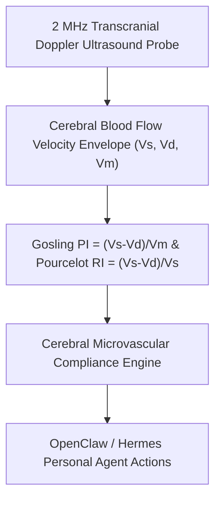

# Transcranial Doppler Gosling Pulsatility Index (PI) Skill

[](LICENSE)
[](https://www.python.org/)
[](requirements.txt)
[](mcp_server.py)
[](SKILL.md)

Zero-dependency sovereign personal agent skill for non-invasive evaluation of Transcranial Doppler Gosling Pulsatility Index (PI), Pourcelot Resistance Index (RI), and cerebral microvascular health.



## Features
- **Deterministic Math**: Pure Python standard library implementation with zero external dependencies.
- **Clinical Neuro-Sonology Standards**: Implements validated Gosling and Pourcelot hemodynamic formulas.
- **Microvascular Aging & Compliance Biomarker**: Early detection of intracranial microvascular stiffening.
- **Model Context Protocol (MCP)**: Native JSON-RPC tool integration for LLMs and autonomous agents.

## Quickstart

```python
from client import CerebralPulsatilityIndexClient

client = CerebralPulsatilityIndexClient()
result = client.evaluate_cerebral_pulsatility(
    peak_systolic_velocity_cm_s=98.0,
    end_diastolic_velocity_cm_s=45.0
)
print("Gosling PI:", result["gosling_pulsatility_index_pi"])
print("Classification:", result["classification"])
```

## License
Apache-2.0
